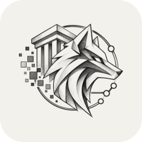

  

<h1 align="center">wolfin.app</h1>

APIs, web apps and digital experiences.

واجهتك للخدمات الرقمية، التطبيقات وواجهات البرمجة.

  <a href="https://wolfin.app"><strong>Explore Wolfin</strong></a> ·
  <a href="https://wolfin.app/blog">Guides & articles</a>

---

## Explore our services

| Service | What it does | Open |
| :--- | :--- | :--- |
| **Flight API** | Search flight schedules, fares and available options through a developer API. | [Read the guide](https://wolfin.app/blog?post=flight-api-guide) |
| **IQ Exchange API** | Access regional Iraqi parallel-market currency quotes for Baghdad, the north and the south. | [Read the guide](https://wolfin.app/blog?post=iq-exchange-api-guide) |
| **QI TV Online** | Explore a library of films, series and live channels in a web interface. | [Open QI TV](https://wolfin.app/tv) |
| **Desktop Wallpaper** | Browse and download a collection of 8K desktop wallpapers. | [Open wallpapers](https://wolfin.app/wallpapers) |

## Get started

1. Visit **[wolfin.app](https://wolfin.app)** and choose a service.
2. Follow its guide for setup, requirements and usage.
3. For APIs, check the service documentation for access, authentication and examples.

For QI TV, start with the **[viewing guide](https://wolfin.app/blog?post=qi-tv-online)**. For wallpapers, see the **[download guide](https://wolfin.app/blog?post=desktop-wallpaper-guide)**.

## In development

**Tawafuq Gold System** and **FinTech Solution** — follow the website for availability and updates.

---

Discover the products. Read the guides. Open everything at <a href="https://wolfin.app"><strong>wolfin.app</strong></a>.

